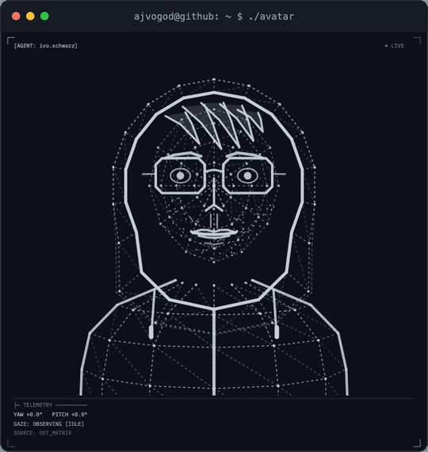

<h3><code>ajvogod@github ~ $ whoami</code></h3>

<table>
<tr>
<td width="42%" valign="top"></td>
<td width="58%" valign="top"></td>
</tr>
</table>

<b>Software, Data &amp; AI Engineer</b> Brno · remote / hybrid

<a href="https://ivoschwarz.com">Portfolio</a>
&nbsp;·&nbsp;
<a href="mailto:ivo.schwarz@catalyma.com">Email</a>
&nbsp;·&nbsp;
<a href="https://www.linkedin.com/in/ivo-schwarz-8577832a2/">LinkedIn</a>

## `$ whoami`

I help businesses put AI to work, connect their systems and reduce unnecessary manual work.

The work covers custom software, AI agents, internal applications and data platforms, from understanding the problem and designing the architecture to implementation, integration and deployment. Recent projects include invoice extraction into a CRM, customer email triage with draft replies for human approval, and data warehouses that bring business systems together.

Alongside development, I offer technical consulting, training, workshops and mentoring. Available for consulting and open to job offers.

## `$ ls ./projects`

### [SmartPlatform](https://ivoschwarz.com/site/#SmartPlatform)

Enterprise AI workspace for searching company knowledge, asking questions and running agents. My work spans connectors, ingestion, hybrid search, access control, model routing and the web application.

`Python` · `FastAPI` · `OpenSearch` · `Celery` · `Redis` · `Next.js` · `LiteLLM` · `Docker`

### [Debtora](https://debtora.cz)

Live B2B service for checking Czech companies and individuals against official registries before signing a contract. Includes insolvency and VAT checks, risk assessment, ongoing monitoring, PDF reports and payments.

`Supabase` · `PostgreSQL + RLS` · `Deno` · `PayU` · `Fakturoid` · `Cloudflare Pages`

### [TEDOM DWH](https://ivoschwarz.com/site/#TEDOM-DWH)

Data platform for an energy supplier. ETL from a dozen sources into an on-premises SQL Server warehouse, a catalog with lineage and Text-to-SQL, and mandatory reporting for the energy regulator.

`C#` · `.NET` · `SQL Server` · `T-SQL` · `Oracle` · `SQL Agent` · `Microsoft Graph` · `Vue` · `MCP`

### [Power BI](https://ivoschwarz.com/site/#PowerBI)

Company-wide report catalog with Entra ID access, access requests and AI-drafted documentation. The work also covers data models, DAX, Power Query and editing reports as code with PBIR.

`NestJS` · `React` · `TypeScript` · `Power BI REST API` · `Entra ID` · `DAX` · `Power Query` · `PBIR`

### [AI agents](https://ivoschwarz.com/site/#AI-Agents)

Agents for customer care, invoice extraction and questions over a data warehouse, plus my own coding agents. Depending on the task, these run as custom applications or workflows in n8n and Make.

`Python` · `.NET` · `n8n` · `Make` · `TypeSafe Jev` · `MCP` · `PostgreSQL + pgvector`

## `$ ls ./open-source`

- [powerbi-mcp](https://github.com/AjvoGod/powerbi-mcp): MCP server for Power BI, with PBIX analysis, semantic model extraction, report export and cloud operations.
- [mcp-sql-agent](https://github.com/AjvoGod/mcp-sql-agent): read-only SQL MCP server for PostgreSQL and SQL Server, with schema introspection and safety guards for AI assistants.

## `$ cat ./stack`

| Area | Tools |
| --- | --- |
| Languages | Python, TypeScript, JavaScript, C#, SQL |
| Web | React, Next.js, Vue, Vite, Tailwind CSS |
| APIs | FastAPI, .NET / ASP.NET Core, NestJS, Node.js, Deno |
| Data | SQL Server, PostgreSQL, Oracle, OpenSearch, Redis, Supabase, Power BI |
| AI & automation | MCP, RAG, AI agents, TypeSafe Jev, OpenRouter, LiteLLM, Semantic Kernel, n8n, Make |
| Engineering | Docker, GitHub Actions, Playwright, Entra ID, Microsoft Graph |
| Coding tools | Claude Code, Codex, Cursor |

Also working with Rust; learning Zig and Odin.

## `$ ./contributions.sh`

<picture>
  <source media="(prefers-color-scheme: light)" srcset="https://www.gitskins.com/api/section/heatmap?username=ajvogod&theme=aurora&style=terminal&mode=light&v=202608071535" />
  
</picture>
